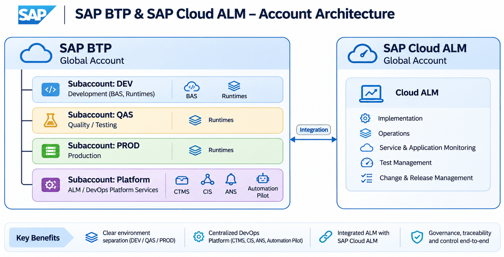
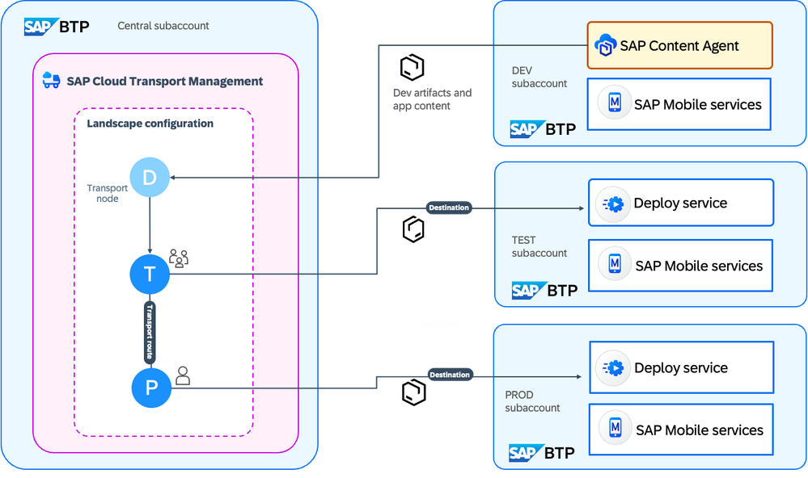
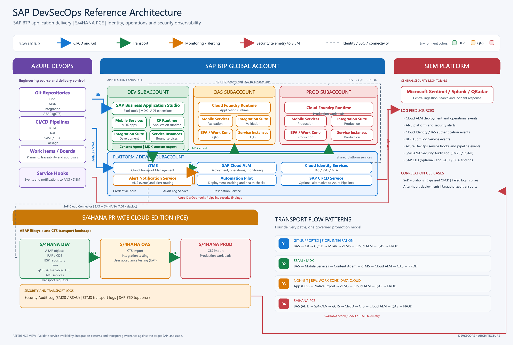

# DevSecOps Strategy


**SAP Business Technology Platform Applications**

**Azure DevOps & SAP Cloud ALM Integration**

| Field | Value |
| --- | --- |
| Document Version | 3.3 |
| Date | November 2026 |
| Author | Rodion RODIONOV |
| Organization | SAP SE – Cross-Solution Delivery, Integrated Toolchain |

# Document Control
## Revision History
| Version | Date | Author | Changes |
| --- | --- | --- | --- |
| 0.1 | October 2026 | R. Rodionov | Initial draft |
| 1.0 | November 2026 | Harshit Madania | Stakeholder review comments |
| 3.2 | November 2026 | R. Rodionov | Added: BAS→S/4HANA PCE deployment, deployment roles matrix, SIEM integration, SSAM MDK clarification |

## Reviewers & Approvers
| Role | Name | Status | Date |
| --- | --- | --- | --- |
| Solution Architect | [TBD] | Pending |  |
| Security Lead | [TBD] | Pending |  |
| DevOps Lead | [TBD] | Pending |  |
| Project Manager | [TBD] | Pending |  |

## Distribution
| Audience | Access Level |
| --- | --- |
| Project Delivery Team | Full |
| Customer IT Operations | Full |
| SAP Security & Compliance | Full |
| Executive Sponsors | Summary only |

## Table of Contents

- [DevSecOps Strategy](#devsecops-strategy)
- [Document Control](#document-control)
  - [Revision History](#revision-history)
  - [Reviewers & Approvers](#reviewers-approvers)
  - [Distribution](#distribution)
- [1. Executive Summary](#1-executive-summary)
- [2. Scope & Objectives](#2-scope-objectives)
  - [2.1 In Scope](#21-in-scope)
  - [2.2 Out of Scope](#22-out-of-scope)
  - [2.3 Objectives](#23-objectives)
- [3. BTP Landscape Architecture](#3-btp-landscape-architecture)
  - [3.1 Subaccount Topology](#31-subaccount-topology)
  - [3.2 Core Platform Services](#32-core-platform-services)
    - [SAP Cloud Identity Services (CIS)](#sap-cloud-identity-services-cis)
    - [SAP Cloud Transport Management Service (CTMS)](#sap-cloud-transport-management-service-ctms)
    - [SAP Cloud ALM](#sap-cloud-alm)
- [4. Source Code Management – Git in Azure DevOps](#4-source-code-management-git-in-azure-devops)
  - [4.1 Repository Strategy](#41-repository-strategy)
  - [4.2 Branching Model](#42-branching-model)
  - [4.3 Code Review & Pull Request Policies](#43-code-review-pull-request-policies)
- [5. Application Pipeline Strategy](#5-application-pipeline-strategy)
  - [5.1 Git-Supported Applications](#51-git-supported-applications)
    - [5.1.1 SSAM – Mobile Development (SAP Mobile Services / MDK)](#511-ssam-mobile-development-sap-mobile-services-mdk)
      - [Deployment Package Location](#deployment-package-location)
      - [Quality Checks Before Bundle Creation (Pre-Export Stage)](#quality-checks-before-bundle-creation-pre-export-stage)
      - [Validation After Bundle Creation (Post-Export Stage)](#validation-after-bundle-creation-post-export-stage)
      - [Transport Mechanism: SAP Content Agent → cTMS](#transport-mechanism-sap-content-agent-ctms)
      - [Prerequisites for MDK → cTMS Integration](#prerequisites-for-mdk-ctms-integration)
      - [End-to-End Flow](#end-to-end-flow)
    - [5.1.2 SAP Fiori Applications](#512-sap-fiori-applications)
  - [5.2 Non-Git Applications](#52-non-git-applications)
    - [5.2.2 SAP Build Work Zone](#522-sap-build-work-zone)
- [6. CI/CD Pipeline Design](#6-cicd-pipeline-design)
  - [6.1 Pipeline Architecture](#61-pipeline-architecture)
  - [6.2 Build & Quality Gates](#62-build-quality-gates)
  - [6.3 Security Scanning in Pipeline](#63-security-scanning-in-pipeline)
- [7. Deployment Strategy](#7-deployment-strategy)
  - [7.1 SAP Cloud Transport Management Service (CTMS)](#71-sap-cloud-transport-management-service-ctms)
    - [Transport Nodes](#transport-nodes)
  - [7.2 SAP Cloud ALM Integration](#72-sap-cloud-alm-integration)
    - [Cloud ALM Deployment Logging](#cloud-alm-deployment-logging)
  - [7.3 Transport Routes](#73-transport-routes)
  - [7.4 Deployment Roles & Authorization Matrix](#74-deployment-roles-authorization-matrix)
    - [7.4.1 BTP Application Deployments (via CTMS + Cloud ALM)](#741-btp-application-deployments-via-ctms-cloud-alm)
    - [7.4.3 Segregation of Duties Summary](#743-segregation-of-duties-summary)
- [8. Security Strategy](#8-security-strategy)
  - [8.1 SAP Cloud Identity Services (CIS)](#81-sap-cloud-identity-services-cis)
  - [8.2 Secrets & Credential Management](#82-secrets-credential-management)
  - [8.3 Static Application Security Testing (SAST)](#83-static-application-security-testing-sast)
  - [8.4 Dependency & Vulnerability Scanning (SCA)](#84-dependency-vulnerability-scanning-sca)
- [9. Monitoring, Logging & Alerting](#9-monitoring-logging-alerting)
  - [9.1 SAP Cloud ALM – Deployment Logging](#91-sap-cloud-alm-deployment-logging)
    - [Logging Matrix](#logging-matrix)
  - [9.2 CI/CD Build Failure Logging](#92-cicd-build-failure-logging)
  - [9.3 SAP Alert Notification Service (ANS) for BTP](#93-sap-alert-notification-service-ans-for-btp)
    - [Alert Configuration](#alert-configuration)
  - [9.4 SIEM Integration](#94-siem-integration)
    - [9.4.1 Log Sources & SIEM Feeds](#941-log-sources-siem-feeds)
    - [9.4.2 SIEM Correlation Rules](#942-siem-correlation-rules)
    - [9.4.3 Supported SIEM Platforms](#943-supported-siem-platforms)
- [10. Automation & Orchestration](#10-automation-orchestration)
  - [10.1 SAP Automation Pilot](#101-sap-automation-pilot)
    - [Key Use Cases](#key-use-cases)
  - [10.2 Deployment Tracking & Self-Healing](#102-deployment-tracking-self-healing)
- [11. Governance & Compliance](#11-governance-compliance)
  - [11.1 Change Management Governance](#111-change-management-governance)
  - [11.2 Audit Trail](#112-audit-trail)
  - [11.3 Compliance Policies](#113-compliance-policies)
- [12. Roles & Responsibilities](#12-roles-responsibilities)
- [13. Appendix](#13-appendix)
  - [A. Glossary](#a-glossary)
  - [B. Reference Architecture Diagram](#b-reference-architecture-diagram)
  - [C. Pipeline YAML Template (SAP BTP CI/CD)](#c-pipeline-yaml-template-sap-btp-cicd)
  - [D. CTMS Configuration Reference](#d-ctms-configuration-reference)
  - [E. SIEM Configuration Reference](#e-siem-configuration-reference)
# 1. Executive Summary
This document defines the DevSecOps strategy for managing the full lifecycle of the following SAP Business Technology Platform (BTP) applications for QatarEnergy:
- **SSAM (Mobile)** – built with SAP Mobile Development Kit (MDK) on SAP Mobile Services
- **SAP Fiori Applications** – UI5 apps and CAP services deployed to both BTP and S/4HANA
- **SAP Build Work Zone** – site and content federation management

CI/CD is handled by the **SAP BTP Continuous Integration & Delivery (CI/CD) service**, using its supported pipeline scenarios — **Cloud Foundry Environment** (Fiori/CAP on SAP BTP) and **SAP Fiori for ABAP Platform** (Fiori on on-premise S/4HANA). SSAM (MDK) has no supported CI/CD scenario and is transported via SAP Content Agent → cTMS under Cloud ALM governance. Source code is managed in Azure DevOps Git. Deployment is orchestrated through SAP Cloud Transport Management (CTMS) with governance via SAP Cloud ALM. Security is embedded at every stage.

The strategy integrates the following SAP and Microsoft platform services into a cohesive DevSecOps toolchain:
| Service | Role in Toolchain |
| --- | --- |
| Azure DevOps (Git) | Source code management, branching, pull requests |
| SAP BTP CI/CD Service | Build, test, security scan, MTAR packaging for Fiori/CAP (Cloud Foundry Environment & SAP Fiori for ABAP Platform scenarios) |
| SAP Cloud Transport Management (CTMS) | Transport orchestration across DEV → QAS → PROD |
| SAP Cloud ALM | Change & deployment management, monitoring, logging |
| SAP Cloud Identity Services (CIS) | Identity federation, SSO, role-based access |
| SAP Alert Notification Service | Real-time alerting for BTP platform and application events |
| SAP Automation Pilot | Deployment tracking, automated remediation |

Key Principle: Security is embedded at every stage – from code commit (pre-commit hooks, branch policies) through build (SAST, dependency scanning) to deployment (transport approval workflows, audit logging). This is DevSecOps, not Dev-then-Sec-then-Ops.
# 2. Scope & Objectives
## 2.1 In Scope
| Area | Details |
| --- | --- |
| Applications | SSAM (Mobile/MDK), SAP Fiori, SAP Build Work Zone |
| Source Control | Azure DevOps Git repositories |
| CI/CD | SAP Continuous Integration & Delivery service |
| Transport & Deployment | SAP CTMS, SAP Cloud ALM Features/Deployment Management |
| Security | SAST, SCA, secrets management, identity governance (CIS) |
| Monitoring & Alerting | Cloud ALM operations, Alert Notification Service, Automation Pilot |
| Environments | DEV, QAS, PROD subaccounts on SAP BTP |

## 2.2 Out of Scope

- SAP S/4HANA (ABAP part) on-premise or private cloud change management (ChaRM/CTS+)
- Non-SAP application pipelines
- Azure DevOps Pipelines (CI/CD is handled exclusively by the SAP BTP CI/CD service)
- Infrastructure-as-Code for BTP subaccount provisioning (unless Automation Pilot is extended)

## 2.3 Objectives

- Standardize the development-to-production lifecycle for all SAP BTP applications.
- Shift security left – embed security checks into every CI/CD pipeline stage.
- Ensure traceability – every deployment to QAS/PROD must be traceable to a Cloud ALM feature/change, a Git commit (where applicable), and an approval workflow.
- Automate repetitive deployment and monitoring tasks via Automation Pilot.
- Centralize logging – all deployment activities and CI/CD outcomes logged in Cloud ALM.
- Alert proactively – leverage Alert Notification Service for real-time incident detection.

# 3. BTP Landscape Architecture
## 3.1 Subaccount Topology
The BTP landscape follows a three-tier subaccount model aligned with the standard SAP transport landscape. An additional platform services subaccount hosts shared DevSecOps tooling.



| Subaccount | Purpose | Key Services |
| --- | --- | --- |
| DEV | Development & unit testing. Developers deploy freely. CTMS source node. | SAP Business Application Studio (BAS), application runtimes, service instances |
| QAS | Quality assurance, integration testing, UAT. Deployments only via CTMS transport. | Application runtimes, service instances (cloned from DEV config) |
| PROD | Production. Deployments only via approved CTMS transport from QAS. | Application runtimes, service instances (production-grade sizing) |
| Platform / DevOps | Shared DevSecOps services. Not application-specific. | CTMS, Cloud ALM (if BTP-based), CI/CD service, Alert Notification, Automation Pilot, CIS tenant |

```
BTP Global Account
  ├─ Subaccount: DEV          (development, BAS, runtimes)
  ├─ Subaccount: QAS          (quality, testing)
  ├─ Subaccount: PROD         (production)
  └─ Subaccount: Platform     (CTMS, CIS, ANS, Automation Pilot)

Cloud ALM Global Account
```

## 3.2 Core Platform Services
### SAP Cloud Identity Services (CIS)
CIS provides the identity layer for the entire BTP landscape:

- Identity Authentication (IAS) – SAML/OIDC-based SSO for all BTP applications and Azure DevOps integration.
- Identity Provisioning (IPS) – automated user and group provisioning across subaccounts.
- Identity Directory – central user store for BTP, federated with corporate IdP (e.g., Azure AD / Entra ID).

### SAP Cloud Transport Management Service (CTMS)
CTMS orchestrates the movement of application content (MTAR files, BPA projects, Work Zone content, Data Cloud artifacts) across the three-tier landscape. Transport nodes map to subaccounts; transport routes enforce the DEV → QAS → PROD flow.
### SAP Cloud ALM
Cloud ALM serves as the central governance and operations hub:

- Features / Change Management – tracks requirements and changes linked to deployments.
- Deployment Management – approves and triggers CTMS transports, logs outcomes.
- Operations – health monitoring, real user monitoring, integration monitoring.

Design Decision: Cloud ALM is subscribed in the Platform subaccount (or as a SaaS subscription at global-account level) to maintain independence from any single application subaccount. CTMS and CIS are similarly centralized.
# 4. Source Code Management – Git in Azure DevOps
## 4.1 Repository Strategy
All Git-supported applications use Azure DevOps Git as the central source code management platform. Repository naming follows a consistent convention:
| Application | Repository Name Pattern | Example |
| --- | --- | --- |
| SSAM Mobile | sap-mobile-{app-name} | sap-mobile-field-service |
| Fiori Apps | sap-fiori-{app-name} | sap-fiori-purchase-orders |

## 4.2 Branching Model
A trunk-based development model with short-lived feature branches is recommended:
| Branch | Purpose | Lifetime | Protection |
| --- | --- | --- | --- |
| main | Production-ready code. Triggers deployment to DEV via CI/CD. | Permanent | Branch policy: PR required, min. 1 reviewer, build must pass, linked work item |
| feature/* | Developer feature branches. Created from main. | Short-lived (days) | None (developer workspace) |
| hotfix/* | Emergency production fixes. Created from main. | Short-lived (hours) | PR required, expedited review |
| release/* | Optional: stabilization branch before QAS promotion. | Short-lived (sprint) | PR required, full review |

```
feature/ABC-123 → Pull Request → main → CI/CD Build → MTAR → CTMS (DEV) → Cloud ALM approval → CTMS (QAS) → CTMS (PROD)
```
## 4.3 Code Review & Pull Request Policies
Azure DevOps branch policies enforce the following on the main branch:

- **Minimum reviewers:** At least 1 reviewer must approve (2 recommended for production-critical apps).
- **Build validation:** The CI pipeline must pass (build + unit tests + SAST scan) before merge.
- **Work item linking:** Every PR must be linked to an Azure DevOps work item (mapped to a Cloud ALM feature).
- **Comment resolution:** All review comments must be resolved before merge.
- **No direct pushes:** All changes to main must go through a PR.
- **Security Gate:** PRs that fail the SAST scan or introduce critical/high-severity vulnerabilities in dependency scanning are automatically blocked from merging.
# 5. Application Pipeline Strategy
## 5.1 Git-Supported Applications
These applications are developed in SAP Business Application Studio (BAS) and version-controlled in Azure DevOps Git. **SAP Fiori** applications are built and deployed by the SAP BTP CI/CD service (supported scenarios only). **SSAM (MDK)** has no supported SAP BTP CI/CD scenario and is transported via SAP Content Agent → cTMS under Cloud ALM governance (see 5.1.1). All deployments are orchestrated through CTMS with Cloud ALM approval.
### 5.1.1 SSAM – Mobile Development (SAP Mobile Services / MDK)
SSAM mobile applications are built using the SAP Mobile Development Kit (MDK). MDK apps are metadata-driven: the developer creates MDK metadata (rules, actions, pages, services) in BAS, and this metadata is deployed to SAP Mobile Services, which interprets it at runtime on the mobile device. MDK apps do not produce a compiled MTAR via the MBT build tool.

> **Important constraint – no SAP BTP CI/CD scenario for MDK.** The SAP Continuous Integration and Delivery service supports a fixed set of pipeline scenarios: Cloud Foundry Environment, SAP Fiori for ABAP Platform, SAP Integration Suite Artifacts, Kyma Runtime, and gCTS for ABAP Development. **There is no MDK / SAP Mobile Services scenario.** SSAM MDK content therefore cannot be built, scanned, or deployed by the SAP BTP CI/CD service. Quality is enforced through BAS-native MDK validation, Azure DevOps pull-request review, and SAP Cloud ALM governance over the SAP Content Agent → cTMS transport. If an SSAM solution includes a CAP/Node.js backend service, only that backend is eligible for a SAP BTP CI/CD pipeline (via the Cloud Foundry Environment scenario); the MDK front-end metadata is not.

#### Deployment Package Location
The SSAM deployment package is an **MDK metadata content package** assembled by **SAP Content Agent** running in the **DEV subaccount**. It is generated from the live MDK content that the developer has deployed to SAP Mobile Services on DEV — not by a CI/CD build.

Package generation flow:
1. Developer validates and deploys MDK metadata to SAP Mobile Services (DEV subaccount) from BAS.
2. SAP Content Agent UI (in DEV subaccount) discovers the MDK app content from Mobile Services.
3. Content Agent packages the content as a transport request and forwards it to cTMS (DEV node).
4. The resulting package in cTMS is the deployable artifact that travels DEV → QAS → PROD.

#### Quality Checks Before Bundle Creation (Pre-Export Stage)
Because no SAP BTP CI/CD scenario exists for MDK, the quality activities performed before the Content Agent export are **not** run in the CI/CD service:

| Check | Where it runs | Gate |
| --- | --- | --- |
| MDK metadata validation (schema, rule syntax, references) | BAS MDK editor (built-in validation) | No validation errors |
| Peer code review of MDK source | Azure DevOps pull request | PR approved, comments resolved |
| Backend service scan (SAST/SCA) – only if the solution has a CAP/Node.js backend | SAP BTP CI/CD service, Cloud Foundry Environment scenario (backend repo only) | No critical/high findings |
| Functional validation on Mobile Services (DEV) | Manual / BAS preview | MDK app runs correctly on DEV |

#### Validation After Bundle Creation (Post-Export Stage)
After Content Agent creates the transport bundle in cTMS, the following activities are performed before the bundle is promoted to QAS:

| Activity | Description | Responsible |
| --- | --- | --- |
| Transport package integrity check | Cloud ALM verifies the transport request is complete and linked to a Cloud ALM feature | Cloud ALM (automated) |
| QA smoke test on DEV | QA validates MDK app behaviour on Mobile Services (DEV) before QAS approval | QA Lead |
| Cloud ALM deployment approval | QA Lead reviews validation evidence and QA sign-off, then approves transport to QAS | QA Lead (manual approval) |
| Post-deploy validation on QAS | Smoke tests run against Mobile Services (QAS) after transport import | Automation Pilot |

#### Transport Mechanism: SAP Content Agent → cTMS
MDK app content is transported via SAP Cloud Transport Management Service (cTMS) using the SAP Content Agent service. This is the official, SAP-documented integration path. For step-by-step configuration, see the SAP tutorial: [Transport Mobile Apps Using SAP Content Agent](https://developers.sap.com/tutorials/btp-content-agent-transport-mobile-apps/).



The diagram shows the end-to-end transport: SAP Content Agent in the central (DEV) subaccount exports the MDK app content to the cTMS transport node (D), which follows the configured transport route to TEST (T) and PROD (P). Each target subaccount uses a Deploy service destination to import the content into its SAP Mobile Services instance.

| Aspect | Details |
| --- | --- |
| Development IDE | SAP Business Application Studio (BAS) with MDK extensions |
| Source Control | Azure DevOps Git (MDK project source files) |
| CI/CD Platform | Not applicable to MDK content – no SAP BTP CI/CD scenario for MDK. A CAP/Node.js backend, if present, uses the Cloud Foundry Environment scenario. |
| Build Artifact | MDK metadata content package (assembled by SAP Content Agent – not an MTAR from MBT) |
| Transport Tool | SAP Content Agent UI → exports MDK content from Mobile Services → creates transport request in cTMS |
| Transport Engine | SAP Cloud Transport Management Service (cTMS) |
| Governance | SAP Cloud ALM – orchestrates approval and deployment of cTMS transports |
| Deployment Path | Mobile Services (DEV) → Content Agent → cTMS [DEV] → CALM Approval → cTMS [QAS] → CALM Approval → cTMS [PROD] |

#### Prerequisites for MDK → cTMS Integration
| Prerequisite | Details |
| --- | --- |
| SAP Content Agent service | Subscribed in the DEV subaccount. Provides the Content Agent UI for content discovery and export. |
| cTMS destination | A destination (e.g., TransportManagementService) configured in the DEV subaccount using cTMS service key credentials. |
| SAP Mobile Services | MDK app must be deployed to Mobile Services on the DEV subaccount. The Content Agent discovers content from Mobile Applications > Native/MDK. |
| cTMS transport landscape | Transport nodes (DEV, QAS, PROD) and routes configured in cTMS, mapped to respective BTP subaccounts. |
| Cloud ALM connection | cTMS connected to Cloud ALM for deployment orchestration and approval workflows. |

#### End-to-End Flow
```
BAS (MDK) → validate in MDK editor → Git push to Azure DevOps (PR review)
          → deploy MDK metadata to SAP Mobile Services (DEV)
Content Agent (DEV) → export MDK content → cTMS [DEV]
Cloud ALM approval → cTMS import to QAS (Mobile Services QAS) → QA smoke test
Cloud ALM approval → cTMS import to PROD (Mobile Services PROD)
```

### 5.1.2 SAP Fiori Applications
Fiori/UI5 applications are the primary workload that the SAP BTP CI/CD service builds and deploys. Two supported pipeline scenarios apply, depending on the deployment target:

| Deployment Target | SAP BTP CI/CD Scenario | Build / Artifact | Deploy Step |
| --- | --- | --- | --- |
| SAP BTP (Cloud Foundry / HTML5 Repository) | **Cloud Foundry Environment** (SAP Fiori / CAP job) | MBT build → MTAR | Deploy to Cloud Foundry, or upload MTAR to cTMS for governed transport |
| On-premise S/4HANA (ABAP platform / BSP repository) | **SAP Fiori for ABAP Platform** | UI5 build → SAPUI5 ABAP repository (BSP) | Deploy to S/4HANA ABAP platform via ADT/RFC destination; creates an ABAP transport request |

| Aspect | Details |
| --- | --- |
| Development IDE | SAP Business Application Studio (BAS) with Fiori tools |
| Source Control | Azure DevOps Git |
| CI/CD Platform | SAP BTP Continuous Integration & Delivery (CI/CD) service |
| CI/CD Scenario (BTP target) | Cloud Foundry Environment |
| CI/CD Scenario (S/4HANA target) | SAP Fiori for ABAP Platform |

**Cloud Foundry Environment pipeline (deployment to SAP BTP):**
```
Developer (BAS) → Git Push → SAP BTP CI/CD (Cloud Foundry Environment):
  1. Build (npm install, UI5 / MBT build → MTAR)
  2. Unit tests (QUnit / OPA5)
  3. Static checks + compliance/malware scan
  4. Deploy MTAR to Cloud Foundry, or upload to cTMS [DEV]
  → Cloud ALM approval → cTMS to QAS → Cloud ALM approval → cTMS to PROD
```

**SAP Fiori for ABAP Platform pipeline (deployment to S/4HANA):**
```
Developer (BAS) → Git Push → SAP BTP CI/CD (SAP Fiori for ABAP Platform):
  1. Build (npm install, UI5 build)
  2. Lint + unit tests (karma)
  3. Deploy to S/4HANA SAPUI5 ABAP repository (BSP) via ADT/RFC destination
  4. ABAP transport request created on S/4HANA DEV
  → Cloud ALM approval → transport import to S/4HANA QAS → PROD
```

## 5.2 Non-Git Applications
SAP Build Work Zone does not use Git-based source control. Configuration is managed directly in the Work Zone admin console and transported via CTMS with Cloud ALM governance. Security controls are based on configuration governance, role-based access control, and change approval workflows.

### 5.2.2 SAP Build Work Zone
| Aspect | Details |
| --- | --- |
| Development | SAP Build Work Zone admin console (site configuration, content federation) |
| Source Control | Not applicable |
| CI/CD | Not applicable |
| Transport Mechanism | CTMS (site content transport) |
| Deployment Path | Work Zone (DEV) → CTMS → Cloud ALM approval → QAS → PROD |

```
Admin (Work Zone, DEV) → Configure site / content → CTMS export → Cloud ALM approval → CTMS transport to QAS → CTMS transport to PROD
```


# 6. CI/CD Pipeline Design
## 6.1 Pipeline Architecture
CI/CD pipelines are implemented using the **SAP BTP Continuous Integration & Delivery (CI/CD) service**. Azure DevOps Git is used for source code management only; the SAP BTP CI/CD service connects to Azure DevOps repositories as its source.

The service supports a fixed set of pipeline scenarios. Only the scenarios relevant to the in-scope applications are used:

| SAP BTP CI/CD Scenario | Used for | In Scope |
| --- | --- | --- |
| Cloud Foundry Environment | Fiori/CAP apps deployed to SAP BTP (Cloud Foundry / HTML5 Repository) | Yes |
| SAP Fiori for ABAP Platform | Fiori apps deployed to on-premise S/4HANA (BSP repository) | Yes |
| SAP Integration Suite Artifacts | Cloud Integration / API Management artifacts | No (not in scope) |
| Kyma Runtime | Apps running on the Kyma runtime | No (not used) |
| gCTS for ABAP Development | ABAP objects via gCTS | No (not in scope) |

**Note:** There is **no CI/CD scenario for SAP Mobile Development Kit (MDK)**. SSAM is handled via SAP Content Agent → cTMS (see Section 5.1.1), not by the SAP BTP CI/CD service. SAP Build Work Zone is content-based and is likewise transported via CTMS, not built by a pipeline.

| Attribute | Details |
| --- | --- |
| CI/CD Platform | SAP BTP CI/CD service (no Azure DevOps Pipelines) |
| Git Source | Azure DevOps Git repositories |
| Pipeline Scenarios Used | Cloud Foundry Environment; SAP Fiori for ABAP Platform |
| Integration | Native cTMS upload, Cloud ALM status notifications |
| Credentials | Service keys stored in SAP BTP Destination service or SAP Credential Store |

## 6.2 Build & Quality Gates
Every SAP BTP CI/CD pipeline (Cloud Foundry Environment and SAP Fiori for ABAP Platform) must include these stages:
| Stage | Activities | Gate Criteria |
| --- | --- | --- |
| 1. Source | Git checkout, dependency resolution | Clean checkout, no dependency conflicts |
| 2. Build | MBT build, compile, bundle | Build succeeds without errors |
| 3. Test | Unit tests, integration tests | All tests pass, code coverage ≥ threshold (e.g., 70%) |
| 4. Security Scan | SAST, SCA/dependency scan (see Section 8) | No critical/high findings. Medium findings reviewed. |
| 5. Package | Generate MTAR archive | Valid MTAR produced |
| 6. Deploy to DEV | Upload MTAR to CTMS DEV node | CTMS upload succeeds |
| 7. Notify | Update Cloud ALM feature/deployment status; notify team | Cloud ALM status reflects pipeline outcome |

## 6.3 Security Scanning in Pipeline
Security scanning is a mandatory, non-skippable pipeline stage. See Section 8 for the detailed security strategy. In summary:

- **SAST** – SonarQube (or SonarCloud) integrated as a SAP BTP CI/CD pipeline stage. Results posted to Cloud ALM and the development team.
- **SCA / Dependency Scanning** – npm audit, Mend (formerly WhiteSource), or Snyk integrated as a CI/CD pipeline stage after dependency installation.
- **Secrets Detection** – Pre-commit hooks (e.g., detect-secrets) on developer machines to prevent accidental credential commits to Azure DevOps Git.

# 7. Deployment Strategy
## 7.1 SAP Cloud Transport Management Service (CTMS)
CTMS is the single orchestration layer for all application deployments across the BTP landscape, regardless of whether the application is Git-supported or not.
### Transport Nodes
| Node | Mapped Subaccount | Role |
| --- | --- | --- |
| DEV | DEV subaccount | Source node. Receives MTAR uploads from CI/CD pipelines or direct uploads. |
| QAS | QAS subaccount | Target node (from DEV). Receives transports after Cloud ALM approval. |
| PROD | PROD subaccount | Target node (from QAS). Receives transports after Cloud ALM production approval. |

## 7.2 SAP Cloud ALM Integration
Cloud ALM provides the governance layer on top of CTMS:

- **Features:** Every deployable change is linked to a Cloud ALM feature (story/task). This ensures traceability from business requirement to production deployment.
- **Deployment Management:** Cloud ALM triggers and monitors CTMS transports. Transport requests in CTMS are linked to Cloud ALM features.
- **Approval Workflow:** Deployment to QAS requires approval from the QA lead. Deployment to PROD requires approval from the change advisory board (CAB) or designated approver.

### Cloud ALM Deployment Logging
Cloud ALM logs every deployment event:
| Event | Logged Data | Retention |
| --- | --- | --- |
| Transport created | Transport ID, source node, MTAR details, creator, timestamp | Per Cloud ALM retention policy |
| Transport approved | Approver, timestamp, target node | Per Cloud ALM retention policy |
| Transport deployed | Deployment status (success/failed), target node, timestamp, log details | Per Cloud ALM retention policy |
| CI/CD build status | Build result (success/failed), pipeline URL, commit hash | Per Cloud ALM retention policy |

Logging Rule – CI/CD Build Failures: If a CI/CD pipeline build fails, the failure is logged in Cloud ALM (linked to the feature/deployment). If there is no CI/CD pipeline (non-Git applications), any deployment failures are logged in the application’s native monitoring (e.g., BPA execution logs, Work Zone admin logs) and correlated in Cloud ALM via the CTMS transport status.
## 7.3 Transport Routes
Git-Supported Applications (SSAM, Fiori):
BAS → Git Commit → SAP BTP CI/CD Pipeline → Artifact → CTMS [DEV] → Cloud ALM Approval → CTMS [QAS] → Cloud ALM Approval → CTMS [PROD]

SAP Build Work Zone (Non-Git):
Work Zone Admin Console (DEV) → Native Export → CTMS [DEV] → Cloud ALM Approval → CTMS [QAS] → Cloud ALM Approval → CTMS [PROD]


## 7.4 Deployment Roles & Authorization Matrix
This section defines who can perform which deployment activities across the landscape. Strict segregation of duties (SoD) is enforced: the person who develops/uploads cannot approve, and the person who approves cannot import.
### 7.4.1 BTP Application Deployments (via CTMS + Cloud ALM)
| Activity | Description | Responsible Role | Tool / Permission |
| --- | --- | --- | --- |
| Upload / Create Transport | Place content on the cTMS DEV node: Fiori/CAP MTAR via the SAP BTP CI/CD pipeline; MDK and Work Zone content via SAP Content Agent export. | Developer / CI/CD pipeline (Fiori), or DevOps Engineer (manual) | cTMS: ImportOperator role on DEV node. CI/CD service account with cTMS API access. |
| Approve Transport to QAS | Review and approve the transport for deployment to the QAS environment in Cloud ALM. | QA Lead / Test Manager | Cloud ALM: Deployment Manager or Change Approver role.Must NOT be the same person who uploaded. |
| Import to QAS | Execute the transport import into the QAS subaccount. Triggered automatically after Cloud ALM approval, or manually by DevOps. | CTMS (automated)or DevOps Engineer | CTMS: ImportOperator role on QAS node. |
| Approve Transport to PROD | Review and approve the transport for deployment to production in Cloud ALM. Requires successful QAS testing sign-off. | Release Manager / CAB | Cloud ALM: Deployment Manager or Change Approver role.Must NOT be the developer or QAS approver. |
| Import to PROD | Execute the transport import into the PROD subaccount. Triggered after Cloud ALM production approval. | CTMS (automated)or Platform Admin | CTMS: ImportOperator role on PROD node. |

### 7.4.3 Segregation of Duties Summary
Key SoD Rules:

- A Developer can upload/create transports but cannot approve or import to QAS or PROD.
- A QA Approver can approve for QAS but cannot approve for PROD (different approver required).
- A Basis/Platform Admin can import transports but cannot approve them (they execute on behalf of the approver).
- No single person should hold upload + approve + import rights simultaneously.

| Role | Upload | Approve QAS | Import QAS | Approve PROD | Import PROD |
| --- | --- | --- | --- | --- | --- |
| Developer | ✓ | ✗ | ✗ | ✗ | ✗ |
| DevOps Engineer | ✓ | ✗ | ✓ | ✗ | ✓ |
| QA Lead | ✗ | ✓ | ✗ | ✗ | ✗ |
| Release Manager / CAB | ✗ | ✗ | ✗ | ✓ | ✗ |
| Basis / Platform Admin | ✗ | ✗ | ✓ | ✗ | ✓ |
| CI/CD Service Account | ✓ | ✗ | ✗ | ✗ | ✗ |

# 8. Security Strategy
Security is integrated at every stage of the software delivery lifecycle (“shift left”). The following subsections detail the security controls across development, build, deployment, and runtime.
## 8.1 SAP Cloud Identity Services (CIS)
CIS is the identity backbone of the BTP landscape, providing:
| Capability | Implementation |
| --- | --- |
| Single Sign-On (SSO) | All BTP applications and Azure DevOps authenticate via CIS (IAS) using SAML 2.0 or OIDC. Corporate IdP (Azure AD / Entra ID) is federated as a proxy identity provider. |
| Multi-Factor Authentication (MFA) | MFA enforced for all administrative access (BTP cockpit, CTMS admin, Cloud ALM admin) and production deployments. |
| Role-Based Access Control (RBAC) | BTP role collections mapped to CIS groups. Principle of least privilege enforced per subaccount. Developers cannot deploy directly to QAS/PROD. |
| User Provisioning | IPS automates user lifecycle (joiner/mover/leaver) across BTP subaccounts. Deprovisioning is triggered by HR events via corporate IdP. |
| Service-to-Service Auth | OAuth 2.0 client credentials flow for SAP BTP CI/CD pipelines accessing BTP APIs (CTMS upload, Cloud ALM status update). Service keys stored in SAP BTP Destination service or SAP Credential Store. |

## 8.2 Secrets & Credential Management
SAP BTP CI/CD Service: All service keys, API tokens, and credentials are stored in SAP BTP Destination service or SAP Credential Store. Pipeline jobs reference these by name. Never committed to Git.
BTP: Credentials stored in SAP Credential Store or BTP Destination service. Integration flows must externalize all credentials (no hardcoded values).
Pre-commit hooks: detect-secrets or Azure DevOps Credential Scanner runs on every commit to prevent accidental credential exposure.
## 8.3 Static Application Security Testing (SAST)
SAST is a mandatory pipeline stage for all Git-supported applications:

- **Tool:** SonarQube / SonarCloud (recommended), Checkmarx, or Fortify.
- **Integration:** SAP BTP CI/CD pipeline stage; results posted to Cloud ALM and the development team.
- **Gate:** Critical and high findings block the pipeline. Medium findings generate warnings.
- **Coverage:** JavaScript/TypeScript (Fiori, Mobile), Node.js (CAP).

## 8.4 Dependency & Vulnerability Scanning (SCA)

- **Tool:** npm audit (basic), Mend (WhiteSource), or Snyk.
- **Integration:** Runs as a SAP BTP CI/CD pipeline stage after dependency installation.
- **Gate:** Known critical CVEs block the pipeline. License compliance violations flagged.
- **Frequency:** On every build (CI trigger) and scheduled weekly scan of all repositories.

# 9. Monitoring, Logging & Alerting
## 9.1 SAP Cloud ALM – Deployment Logging
Cloud ALM serves as the central audit log for all deployment activities across the landscape:

- Every CTMS transport (create, approve, deploy, reject, fail) is logged with timestamp, actor, and outcome.
- CI/CD pipeline results (build success/failure, test results, scan outcomes) are linked to Cloud ALM features.
- Deployment dashboards in Cloud ALM provide a single pane of glass for all application deployments.

### Logging Matrix
| Application Type | CI/CD Build Log | Deployment Log | Failure Logging |
| --- | --- | --- | --- |
| Git-supported (SSAM, Fiori, Integration with CI/CD) | Azure DevOps Pipeline logs + Cloud ALM | Cloud ALM (via CTMS) | CI/CD failure: Cloud ALM + Azure DevOps. Deployment failure: Cloud ALM. |
| Integration (without CI/CD) | N/A | Cloud ALM (via CTMS) | Deployment failure: Cloud ALM. Runtime errors: Integration Suite monitoring. |
| Non-Git (BPA, Work Zone, Data Cloud) | N/A | Cloud ALM (via CTMS) | Deployment failure: Cloud ALM. Application errors: native app monitoring. |

## 9.2 CI/CD Build Failure Logging
When a CI/CD pipeline build fails:

- The pipeline posts the failure status to Cloud ALM (feature text updated to “Build Failed”).
- The detailed build log remains in the SAP BTP CI/CD service for developer diagnosis.
- A notification is sent via SAP Alert Notification Service (and optionally email/Teams/Slack).
- For non-Git applications (e.g., Work Zone), failures occur at deployment time (CTMS import) and are logged in Cloud ALM deployment management and the application’s native logs.

## 9.3 SAP Alert Notification Service (ANS) for BTP
The SAP Alert Notification Service provides real-time, event-driven alerting for the BTP platform and applications.
### Alert Configuration
| Alert Category | Source | Condition | Action |
| --- | --- | --- | --- |
| Deployment Failure | CTMS / Cloud ALM | Transport import fails on any node | Email + Teams/Slack notification to DevOps team |
| CI/CD Build Failure | Azure DevOps (via webhook to ANS) | Pipeline build/test/scan stage fails | Email notification to development team |
| Application Runtime Error | BTP application logs, Cloud Foundry / Kyma | Error rate exceeds threshold | Email + incident creation in Cloud ALM |
| Security Vulnerability | SCA/SAST tooling | Critical CVE detected in dependency | Urgent email to security lead + DevOps team |
| Platform Health | BTP platform events | Service instance down, quota exceeded, certificate expiry | Email + auto-remediation via Automation Pilot |
| Identity / Access | CIS audit logs | Failed login attempts exceeding threshold, privilege escalation | Email to security team |

Integration Pattern: ANS connects to external channels (email, Microsoft Teams, Slack, ServiceNow, PagerDuty) via webhooks and the SAP BTP Destination service. Cloud ALM can also consume ANS events to create operational incidents.
## 9.4 SIEM Integration
All security-relevant logs from the SAP BTP landscape and S/4HANA PCE systems are forwarded to the organization’s Security Information and Event Management (SIEM) platform for centralized correlation, threat detection, and compliance reporting.
### 9.4.1 Log Sources & SIEM Feeds
| Log Source | Log Type | Feed Mechanism | SIEM Use Case |
| --- | --- | --- | --- |
| SAP Cloud ALM | Deployment events, approval audit trail, feature changes | Cloud ALM API → ANS webhook → SIEM ingestion endpoint (e.g., Splunk HEC, Sentinel Data Connector) | Unauthorized deployment detection, SoD violation monitoring, change audit |
| SAP Alert Notification Service | Platform events, application errors, security alerts | ANS action → Webhook to SIEM | Real-time security event correlation, incident detection |
| SAP Cloud Identity Services (CIS/IAS) | Authentication events, failed logins, MFA events, role changes, user provisioning | IAS Audit Log API → scheduled export to SIEM, or real-time via ANS | Brute-force detection, privilege escalation, access anomaly detection |
| BTP Cloud Foundry / Kyma Audit Log | Service instance creation/deletion, environment changes, security events | SAP Audit Log Viewer API → SIEM ingestion | Infrastructure change tracking, unauthorized service modifications |
| Azure DevOps | Pipeline execution logs, repository access, PR approvals, branch policy overrides | Azure DevOps Service Hooks → SIEM (or Azure Monitor → Sentinel) | CI/CD tampering detection, code access anomalies, policy bypass alerts |
| S/4HANA PCE Security Audit Log | Transaction execution, transport imports, user changes, authorization checks (SM20/RSAU_READ) | SAP Enterprise Threat Detection (ETD) → SIEM, or direct syslog/API export | Unauthorized transport imports, critical transaction monitoring, user behavior analytics |
| SAST / SCA Tools | Security scan findings, vulnerability reports | Tool-native integration (e.g., SonarQube webhook, Snyk API) → SIEM | Vulnerability trend analysis, compliance dashboards |

### 9.4.2 SIEM Correlation Rules
The SIEM platform should be configured with correlation rules specific to the SAP DevSecOps landscape:
| Rule | Detection Logic | Severity |
| --- | --- | --- |
| SoD Violation | Same user uploads and approves a transport within the same change cycle | Critical |
| After-Hours Deployment | Production deployment approved/imported outside business hours without emergency change flag | High |
| Bypassed CI/CD | Transport uploaded to CTMS without a matching CI/CD pipeline run (for Git-supported apps) | High |
| Failed Login Spike | > N failed login attempts on CIS/IAS within M minutes for any single account | High |
| Critical Vulnerability Deployed | SAST/SCA reports critical finding AND transport was still deployed to QAS/PROD | Critical |
| Unauthorized S/4HANA Transport | Transport imported to S/4HANA QAS/PROD without a corresponding Cloud ALM approval | Critical |
| Service Key Rotation Overdue | CI/CD service key or BTP credential older than rotation policy threshold | Medium |

### 9.4.3 Supported SIEM Platforms
| SIEM Platform | Integration Method |
| --- | --- |
| Microsoft Sentinel | Azure DevOps native connector + SAP BTP data via Azure Logic Apps / Function Apps consuming ANS webhooks. SAP S/4HANA via SAP Sentinel Solution (SAL connector). |
| Splunk | ANS → Splunk HTTP Event Collector (HEC). S/4HANA via SAP ETD or direct syslog. Azure DevOps via Splunk Add-on for Azure. |
| SAP Enterprise Threat Detection (ETD) | Native integration with S/4HANA security audit log. Can forward correlated events to external SIEM. |
| IBM QRadar / Other | ANS webhook → syslog or REST API endpoint. Custom parsers for SAP log formats. |

Compliance Requirement: All security-relevant events must be retained in the SIEM for a minimum of 12 months (or as required by the organization’s data retention policy). Cloud ALM, ANS, and CIS audit logs should be exported regularly to prevent data loss due to platform retention limits.

# 10. Automation & Orchestration
## 10.1 SAP Automation Pilot
SAP Automation Pilot is a BTP service that provides automated command execution, scheduling, and orchestration for operational tasks. In the context of this DevSecOps strategy, Automation Pilot serves as the deployment tracking and automated remediation engine.
### Key Use Cases
| Use Case | Description | Trigger |
| --- | --- | --- |
| Deployment Tracking | Track the status of all CTMS transports across the landscape. Aggregate deployment metrics (success rate, mean time to deploy, rollback frequency). | Scheduled (e.g., every 15 minutes) or event-driven (ANS alert) |
| Automated Health Checks | After each deployment to QAS/PROD, run automated smoke tests or health-check commands to validate the deployment. | Post-deployment event from CTMS/Cloud ALM |
| Auto-Remediation | If a deployment fails or a runtime health check detects an issue, Automation Pilot can trigger a rollback or restart the application. | ANS alert (deployment failure or health check failure) |
| Certificate & Credential Rotation | Automated rotation of service keys and certificates used by CI/CD pipelines and BTP services. | Scheduled (before expiry) |
| Environment Provisioning | Automated setup of BTP subaccount configurations, destinations, and service instances for new environments. | On demand |
| Compliance Reporting | Generate periodic reports on deployment compliance (e.g., all PROD deployments have Cloud ALM approval, all Git apps passed SAST). | Scheduled (weekly/monthly) |

## 10.2 Deployment Tracking & Self-Healing
Automation Pilot integrates with CTMS, Cloud ALM, and ANS to create a closed-loop deployment tracking system:

```
1. CI/CD or manual upload → CTMS transport created
2. Cloud ALM approval → CTMS deploys to QAS/PROD
3. Automation Pilot runs post-deployment health check
4. IF health check passes → Cloud ALM status updated to "Deployed Successfully"
5. IF health check fails → ANS alert → Automation Pilot triggers rollback → Cloud ALM status "Rolled Back"
6. Deployment metrics aggregated and reported
```

# 11. Governance & Compliance
## 11.1 Change Management Governance

- Every change deployed to QAS or PROD must be linked to a Cloud ALM feature.
- Git-supported changes must be traceable to a Git commit and Azure DevOps work item.
- Production deployments require documented approval in Cloud ALM (CAB or designated approver).
- Emergency changes follow an expedited workflow but still require post-deployment approval and documentation.

## 11.2 Audit Trail
The combined toolchain provides a complete audit trail:
| Layer | Audit Data | Tool | SIEM Feed |
| --- | --- | --- | --- |
| Code change | Who changed what, when, why | Azure DevOps Git | Yes |
| Code review | Reviewer, approval decision | Azure DevOps PRs | Yes |
| Build & scan | Build result, test coverage, scan outcome | Azure DevOps Pipelines + SonarQube/Snyk | Yes |
| Transport | Transport creation, approval, deploy status | CTMS + Cloud ALM | Yes |
| Approval | Who approved QAS/PROD and when | Cloud ALM | Yes |
| Runtime | Application health, errors, performance | Cloud ALM Operations + ANS | Alerts only |
| Identity | Authentication, authorization events | CIS audit logs | Yes |
| S/4HANA transport | CTS import log, transport release | S/4HANA STMS / SM20 | Yes (via ETD) |

## 11.3 Compliance Policies

- **Segregation of Duties (SoD):** Developers cannot approve their own changes. Separate roles for development, QA approval, and production approval (see Section 7.4).
- **No Direct Production Access:** No developer has direct deployment rights to PROD. All changes go through CTMS + Cloud ALM approval.
- **Regular Access Reviews:** Quarterly review of BTP role assignments and authorizations.
- **Data Protection:** No production data in DEV/QAS. Anonymized or synthetic test data used.
- **SIEM Monitoring:** All deployment and security events forwarded to SIEM. Correlation rules for SoD violations, unauthorized access, and policy bypasses (see Section 9.4).

# 12. Roles & Responsibilities
| Role | Responsibilities | Tools |
| --- | --- | --- |
| Developer | Write code in BAS (Fiori, Mobile/MDK, ABAP), commit to Git, create PRs, fix security findings. Develop BPA/Work Zone/Data Cloud content. Upload transports to DEV only. | BAS, Azure DevOps, BPA Lobby, Work Zone admin, Datasphere, S/4HANA (DEV only) |
| DevOps Engineer | Maintain CI/CD pipelines, manage CTMS configuration, configure Automation Pilot, manage ANS subscriptions, execute imports when needed. | Azure DevOps, CTMS, Automation Pilot, ANS |
| Security Engineer | Configure SAST/SCA tools, manage CIS policies, review scan results, define security gates, manage SIEM rules and dashboards. | SonarQube/Snyk, CIS/IAS, SIEM platform |
| QA Lead | Approve QAS deployments in Cloud ALM, validate test results, run acceptance tests. | Cloud ALM |
| Release Manager / CAB | Approve PROD deployments in Cloud ALM, coordinate release schedules. | Cloud ALM |
| Basis / Platform Admin | Manage BTP subaccounts, S/4HANA system administration, CIS configuration, CTMS nodes, execute CTS imports. | BTP Cockpit, CIS/IAS, CTMS, S/4HANA STMS |

# 13. Appendix
## A. Glossary
| Term | Definition |
| --- | --- |
| ADT | ABAP Development Tools – Eclipse/BAS-based IDE for ABAP development |
| ANS | SAP Alert Notification Service – real-time alerting for BTP events |
| ATC | ABAP Test Cockpit – static analysis and checks for ABAP code |
| BAS | SAP Business Application Studio – cloud-based IDE |
| BPA | SAP Build Process Automation – low-code/no-code process automation |
| BSP | Business Server Pages – ABAP repository for UI5/Fiori apps on S/4HANA |
| BTP | SAP Business Technology Platform |
| CAB | Change Advisory Board |
| CIS | SAP Cloud Identity Services (IAS + IPS + Identity Directory) |
| CTS | Change and Transport System – ABAP transport mechanism in S/4HANA |
| CTMS | SAP Cloud Transport Management Service |
| ETD | SAP Enterprise Threat Detection – SIEM for SAP systems |
| gCTS | Git-enabled Change and Transport System – Git integration for ABAP transports |
| MDK | SAP Mobile Development Kit – metadata-driven mobile app framework |
| MTAR | Multi-Target Application Archive – deployable package for BTP |
| PCE | Private Cloud Edition – SAP-managed on-premise S/4HANA |
| SAST | Static Application Security Testing |
| SCA | Software Composition Analysis (dependency scanning) |
| SIEM | Security Information and Event Management |
| SoD | Segregation of Duties |
| SSAM | SAP Mobile Services application (mobile development using MDK) |

## B. Reference Architecture Diagram



## C. Pipeline YAML Template (SAP BTP CI/CD)
[Insert reference SAP BTP CI/CD service pipeline configuration for the Cloud Foundry Environment (Fiori/CAP MTAR build) and SAP Fiori for ABAP Platform scenarios, including SAST and SCA stages.]
## D. CTMS Configuration Reference
[Insert CTMS node and route configuration details specific to the customer landscape.]
## E. SIEM Configuration Reference
[Insert SIEM correlation rules, log format specifications, and dashboard templates.]
